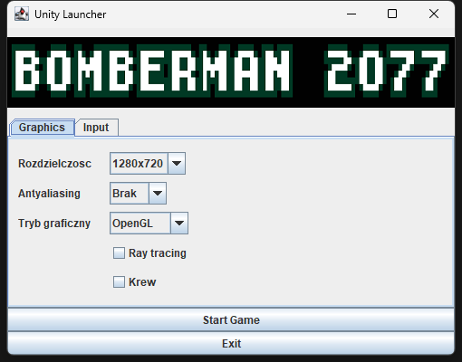
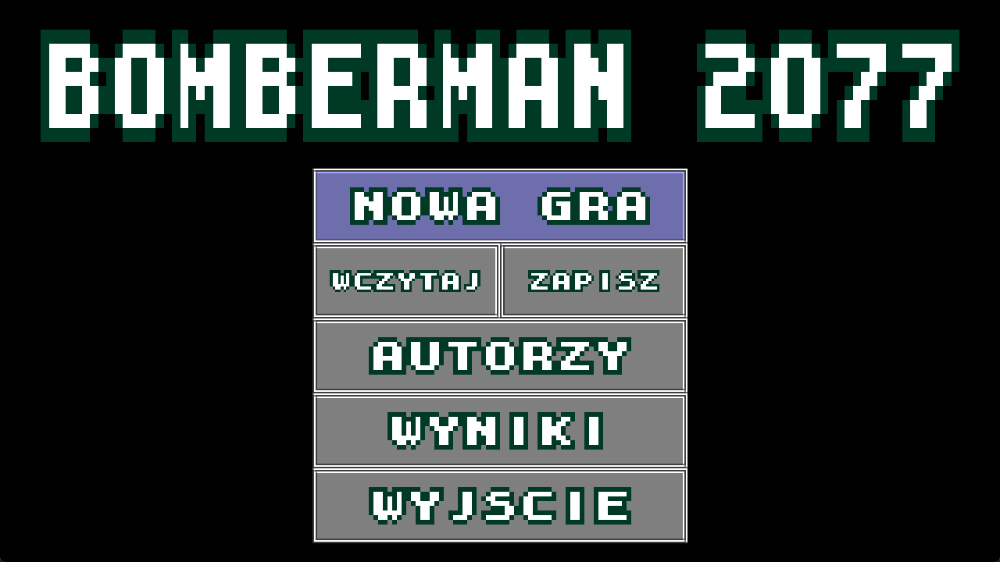
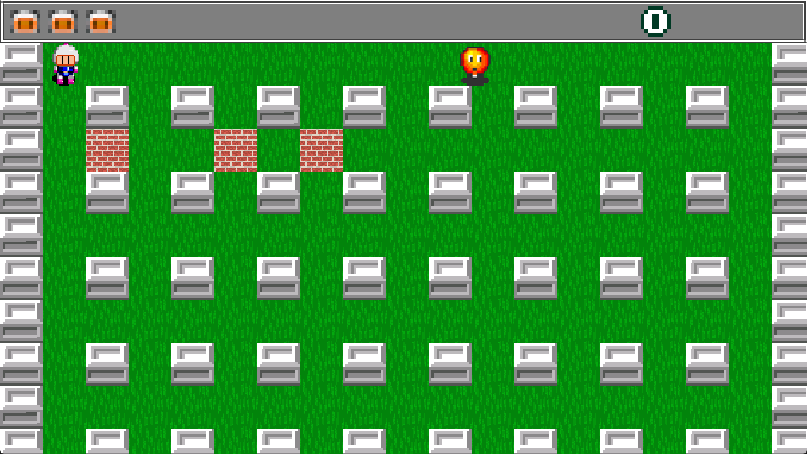
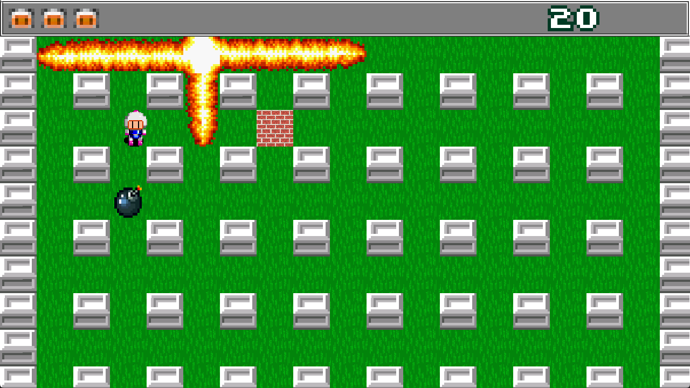

# Bomberman

A 2D Bomberman-style game written in Java with the LWJGL 3 OpenGL bindings. The
player drops bombs to destroy bricks and enemies across several levels, with a
menu, save slots, a high-score board, cut-scenes and sound.

This is a student / personal project; the in-code documentation (Javadoc
comments) is written in Polish.

## Download

Grab `Bomberman-windows-x64.zip` from the
[latest release](https://github.com/DorianKucharski/bomberman/releases/latest),
unzip it and run `Bomberman.exe`. No Java installation is needed - the zip
ships its own trimmed Java runtime.

## Screenshots

| Launcher | Main menu |
| --- | --- |
|  |  |

| Gameplay | Explosion |
| --- | --- |
|  |  |

## Features

- Tile-based world with multiple levels (`levels/`)
- Several enemy types (`Enemy`, `Boss`, `Gumba`, `Pepe`, `Zombie`)
- Bombs, flames and AABB collision detection
- Menu, save/load slots, high-score board, intro and cut-scenes
- Sprite animation, a custom bitmap-font text renderer and a camera
- Sound effects and music (`music/`)
- In-game screenshots (saved to `screenshots/`)

## Tech stack

- Java
- [LWJGL](https://www.lwjgl.org/) 3.1.2 (GLFW, OpenGL, STB)
- Swing (launcher window), Java Sound (audio playback)
- [JOML](https://github.com/JOML-CI/JOML) (math / camera)
- OpenGL shaders (GLSL, in `src/main/resources/shaders/`)

## Building

Requirements: Windows and a JDK 17 or newer (the script needs `jpackage`).
Dependencies (LWJGL 3.1.2, JOML) are downloaded from Maven Central automatically.

```powershell
powershell -ExecutionPolicy Bypass -File build.ps1
```

The script looks for the JDK in `JAVA_HOME`, then in `~/.jdks` and the usual
install folders. Output:

- `build/dist/Bomberman/Bomberman.exe` - ready-to-run app image
- `build/Bomberman-windows-x64.zip` - the same folder zipped for a release

The game opens `levels/`, `music/`, `saves/` and `Wyniki.bin` relative to the
working directory, so start `Bomberman.exe` from its own folder (a double-click
does that).

To run from IntelliJ IDEA instead, add the jars from `build/lib` (created by the
script) to the module classpath and run `com.bomberman.game.Main` with the
repository root as the working directory.

## Controls

| Key | Action |
| --- | --- |
| `W` `A` `S` `D` | move |
| `Space` | drop a bomb |
| `F5` / `F8` | quick save / quick load |
| `F9` | screenshot (saved to `screenshots/`) |
| `Esc` | menu / pause |

## Project structure

- `src/main/java/com/bomberman/` - game source, grouped by package
  (`game`, `entity`, `gui`, `render`, `world`, `io`, `collision`, `assets`,
  `scores`)
- `src/main/resources/` - shaders, textures and save-slot thumbnails
- `levels/` - level definitions (image-based tile maps)
- `music/` - music (OGG Vorbis, decoded with LWJGL's stb_vorbis) and sound effects (WAV)
- `build.ps1` - build script producing the Windows exe
- `screenshots/` - in-game screenshots taken with `F9`
- `docs/screenshots/` - screenshots used in this README
